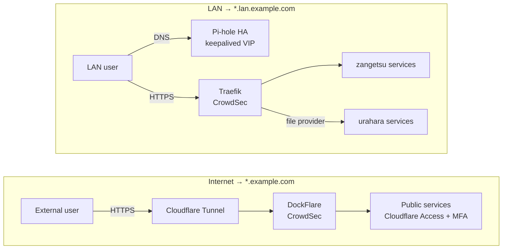
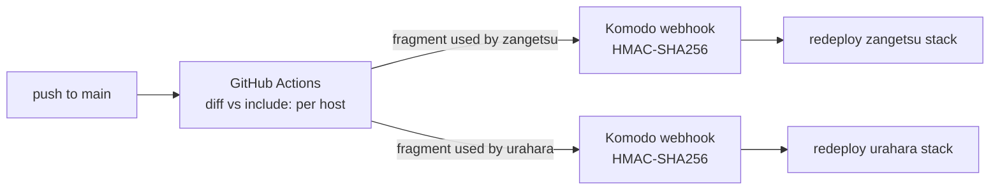

# homelab-as-code

[](https://github.com/thales-machado/homelab-as-code/actions/workflows/validate.yml)

Infrastructure as code for a two-host self-hosted homelab: 51 Docker Compose fragments and 70+ containers, dual-path routing (LAN and internet), highly available DNS, full metrics/logs/alerting, and automated, monitored backups. Deploys are GitOps: a push to `main` redeploys only the host affected by the change.

This is a sanitized public copy of my private homelab repository. Domains, IPs, IDs and secrets are replaced with placeholders, and a few personal services were removed.

## Architecture



- **Private (LAN):** Traefik routes by Docker label, with a public Let's Encrypt wildcard certificate issued over DNS-01, so no port is open to the internet. Pi-hole answers split-horizon DNS and runs active/passive on both hosts behind a keepalived VIP, with config synced by Nebula Sync.
- **Public:** DockFlare turns Docker labels into Cloudflare Tunnel routes; Cloudflare Access with MFA protects anything sensitive, and only webhook paths bypass it.
- **Security:** CrowdSec blocks by IP reputation and behavior on both entry points. Tailscale subnet routers on both hosts give remote access without the public tunnel.

## Hosts

| Host | Hardware | LAN IP | Role |
|---|---|---|---|
| `zangetsu` | Raspberry Pi 5 | `192.168.10.214` | Platform core: routing, DNS, automation, observability |
| `urahara` | GMKtec K8 (Ryzen 7 8845HS) | `192.168.10.215` | Content and media: photos, documents, smart home, game streaming |

Other fixed addresses: `192.168.10.248` is the Pi-hole VIP (keepalived), `192.168.10.200` the NAS, `192.168.10.250` the UniFi controller, and `192.168.10.220` a separate machine outside this repo. All IPs and domains in this repo are placeholders for the real ones.

Each host has a `hosts/<host>/compose.yaml` whose `include:` list is the single source of truth for what runs there. A service is a self-contained fragment in `infra/<category>/<service>/`; if it is not included, it is not running.

## Deploy pipeline



[`deploy.yaml`](.github/workflows/deploy.yaml) parses each host's `include:` list and only triggers the stacks whose fragments changed. A fragment used by both hosts, such as an exporter, redeploys both. Pi-hole DNS records live in [`pihole-dns.yaml`](infra/platform/networking/pi-hole/config/pihole-dns.yaml) and are synced by a signed webhook on change. Renovate keeps image tags current.

## Observability

- **Metrics:** VictoriaMetrics (Prometheus-compatible) scraping node-exporter, cAdvisor, blackbox-exporter, smartctl, Postgres, Redis, UniFi (unpoller), Traefik, CrowdSec, rclone and Watchtower.
- **Logs:** Grafana Alloy ships container and host logs to Loki.
- **Dashboards and alerting:** 10 Grafana dashboards and alert rules provisioned from files in [`grafana/provisioning`](infra/observability/metrics/grafana/provisioning), so a fresh Grafana comes up fully configured.
- **Uptime and disks:** Uptime Kuma, Scrutiny for S.M.A.R.T., Dozzle with an agent per host for live container logs.

## Backup

- **Restic** snapshots `/opt` and `/etc` on both hosts to a dedicated NAS share, with GFS retention (7 daily, 4 weekly, 6 monthly).
- **Databases** get a consistent dump first (`sqlite3 .backup`, `pg_dump`) so no backup depends on copying live files.
- **Dagu** orchestrates the 10 scheduled jobs in [`dags/`](infra/automation/dagu/dags), and every job pings **Healthchecks**. The checks themselves are managed with Terraform in [`terraform/healthchecks`](terraform/healthchecks), with state on Cloudflare R2.
- **NAS mounts** are fixed systemd `.mount` units with `OnFailure=` notifications, and Docker waits for them with `RequiresMountsFor=`, so containers never start writing to an empty mount point.

## Services

| Category | Services |
|---|---|
| Platform | Traefik, DockFlare, cloudflared, Pi-hole (HA), keepalived, Nebula Sync, Tailscale, CrowdSec, Vaultwarden, Komodo, Watchtower, Autoheal, Healthchecks |
| Observability | VictoriaMetrics, Grafana, Loki, Grafana Alloy, exporters, Uptime Kuma, Scrutiny, Dozzle |
| Automation | Dagu, n8n |
| Content | Immich, Paperless-ngx, Stirling PDF, Tandoor |
| Integration | Evolution API |
| Media | Samba, rclone, Wolf (GPU game streaming over Moonlight) |
| Other | Home Assistant, Firefly III, Homepage, Trilium, Vikunja, IT-Tools, OpenSpeedTest |

## Conventions

- Resource limits on every container (`cpus`, `mem_limit`, `pids_limit`).
- Bind mounts under `/opt/apps/<service>/`, never named volumes, so Restic sees everything.
- Secrets only through `env_file: .env`, named `<SERVICE>_<PURPOSE>`; see each host's [`.env.example`](hosts/zangetsu/.env.example).
- Networks declared only in the host `compose.yaml`; fragments only reference them.
- Services reach the Docker API through a socket proxy by default; the few that mount the socket directly are listed, with reasons, in `CONVENTIONS.md`.

The full set of rules, and the incidents behind them, is in [`CONVENTIONS.md`](CONVENTIONS.md).

## Layout

```text
hosts/<host>/compose.yaml    entry point per host: include: list + host overrides
infra/<category>/<service>/  one self-contained Compose fragment per service
scripts/                     setup, backup, networking and systemd units
terraform/healthchecks/      Healthchecks.io checks as code
.github/workflows/           validation CI, path-aware deploy and DNS sync
docs/                        runbooks (backup, Komodo, Traefik/DockFlare)
```

## License

MIT
